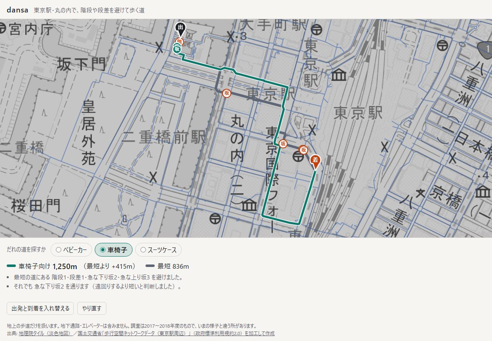
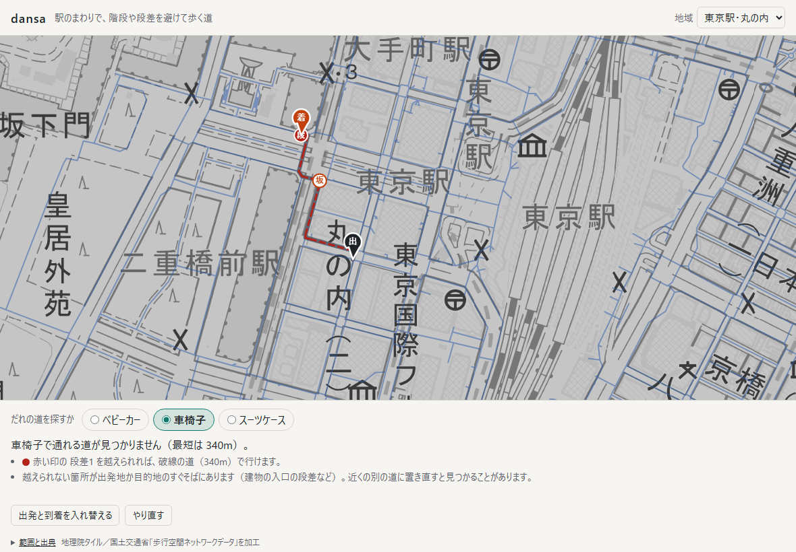
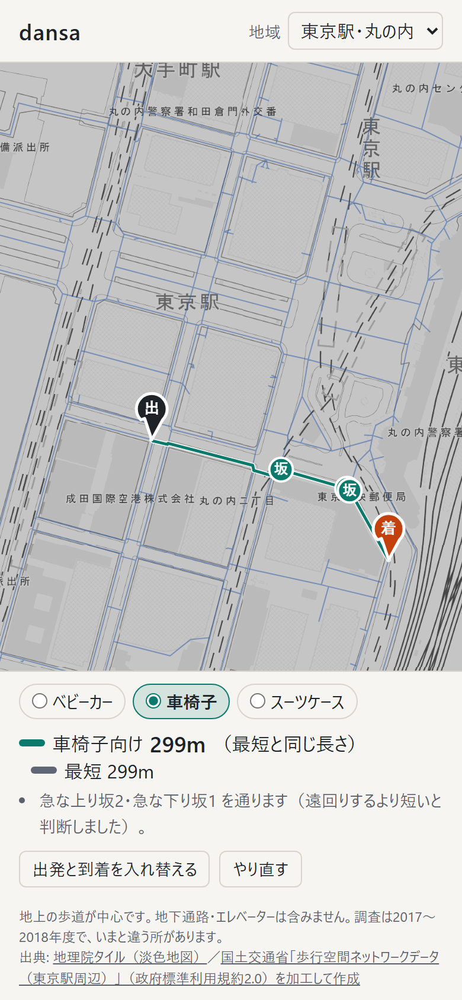

# dansa

東京駅・丸の内で、階段や段差、急な坂を避けて歩く道を探す。ベビーカー・車椅子・スーツケースを切り替えると、同じ2点でも道が変わる。最短の道と並べて、何を避けて何m遠回りしたかを示す。

**アプリ:** https://tame0522works-art.github.io/dansa/ （PC とスマホのブラウザで、開くだけで使える。地図を2回押すと、出発地から目的地までの道が出る）



歩行経路のデータは国土交通省の「歩行空間ネットワークデータ（東京駅周辺）」を使い、道の探索は端末の中で行う。
公開版は Content Security Policy で通信（fetch など）をすべて禁じ、例外は背景の地理院タイルの画像を読むことだけにしている。

## できること

| 同じ2点のベビーカー向け（+9m） | 車椅子で行けないとき | スマホ |
|---|---|---|
|  |  |  |

- **2点を押すだけ**: 地図を押すと出発地、もう一度押すと目的地。いちばん近い道の上の点に寄せる（60m より遠ければ「データがありません」と案内）
- **利用者を切り替える**: ベビーカー・車椅子・スーツケースで、避けるものと避け方が違う（下の表）
- **最短の道と並べる**: 灰色が最短、緑が利用者向け。最短の道にあって避けた障害に印を置き、長さの差と避けた障害の数を出す。避けるより通ったほうが短いと判断した障害（スーツケースの階段など）も示す
- **行けないときは理由を示す**: 越えられない箇所に赤い印を置き、その箇所さえ越えれば行ける道を破線で描く。越えられない箇所が出発地か目的地のすぐそば（建物の入口の段差など）なら、置き直すよう案内する
- **調べられていない区間**: 段差・勾配・幅が不明な区間は点線と「?」の印にする（通れる扱いにして、少し遠回りしてでも避ける）
- **キーボードでも使える**: Tab で地図を選ぶと中央に十字と案内が出る。矢印キーで動かし、+ と − で寄せ引き、Enter で十字の地点を選ぶ。利用者はラジオボタンを矢印キーで選ぶ

## 作りの要点

### データ: 国交省の歩行空間ネットワークデータ

東京駅周辺のデータは、歩行経路を「点」4,161 と「経路」4,947 本（総延長約 113km）で表し、経路ごとに段差・縦断勾配・幅員・階段などの区分を持つ。
仕様（歩行空間ネットワークデータ等整備仕様 2018年3月版）の表と CSV を突き合わせて、使えるものと使えないものを確かめた。

| 分かったこと | どうしたか |
|---|---|
| 段差は「2cm 以下 / 超」、勾配は「5% 以下 / 超（上り・下り）」の区分だけで、cm や % の値はない | 区分だけでコストを決める。「5% を少し超える坂」と「12% の坂」は区別できない |
| 勾配は「起点より終点が高い」の向きで記録されている | 同じ坂でも、通る向きで上りか下りかを切り替える |
| 階層は地上・踊り場・デッキの3つだけで、地下通路は0本、エレベーターの経路も0本 | 地上の歩道だけを扱うと決め、画面に明記する。`check:data` は地下やエレベーターが現れたら止まる |
| 経路は両端を結ぶ直線とほぼ一致する（差は1割以内。0.1m 単位の丸めで、0.2m の経路だけは2割ずれる） | 形状は CSV の両端の点だけで描く |
| 調査は 2017〜2018 年度 | いまの様子と違う所がありうると画面に書く |

取得は `npm run fetch`（配布元は利用者エージェントのない要求に 403 を返す）、変換は `npm run convert` で、
同梱するデータは 175KB（[`src/data/network.json`](src/data/network.json)。座標は東京駅を原点にした cm、長さは dm の整数）。

### 利用者ごとのコスト表

コストの単位は「何 m 歩くのと同じくらい避けたいか」にした。階段と段差は1か所ごとの上乗せ、坂と狭い道は長いほどつらいので長さに掛ける倍率で表す（[`src/route.ts`](src/route.ts)）。

| | ベビーカー | 車椅子 | スーツケース |
|---|---|---|---|
| 階段 | 通れない | 通れない | +150m |
| 段差 2cm 超 | +60m | 通れない | +20m |
| 勾配 5% 超の上り | ×2 | 通れない | ×1.3 |
| 勾配 5% 超の下り | ×1.5 | ×2 | ×1.1 |
| 幅 1m 未満 | ×1.5 | 通れない | ×1.2 |
| 不明な区間 | +50m | +50m | +50m |

**この値は仮置きで、当事者の声や指針で裏付けたものではない。** 表を1か所にまとめてあるので、根拠のある値に差し替えられる。
無作為な2点で車椅子が到達できるのは約8割で、行けない組の原因は急な上り坂・段差・階段・狭い道（北の丸・竹橋あたりに多い）だった。

### 探索と「行けない理由」

探索はダイクストラ法を自前で書いた（隣接は CSR、優先度つきキューは2分ヒープ。1回 約0.5ms）。
行けないときは、通れない障害を「1か所 100km 歩くのと同じ」とみなしてもう一度探す。
こうすると、通れない箇所をいちばん少なく通る道が見つかり、その上の通れない箇所が利用者に示す原因になる。
距離が長くても、通れない箇所が少ない道のほうが選ばれる。

丸の内の中でも車椅子で行けない組があり、調べるとどれも目的地の直前の段差1か所が原因だった（多くは建物の入口）。
そこで、原因が出発地か目的地に接しているときは置き直すよう案内し、出発地・目的地の印をピンにして、地点の上に浮かせた（地点に重なる段差の印を隠さないように）。

### 確かめ方の工夫

- `check:route` は、手で答えの出せる小さなネットワーク（階段の遠回り、坂の向き、段差・幅、不明、行けない理由）に加えて、
  実データ 480 組をすべての辺を緩和し続ける素朴な方法（ベルマン–フォード法）と照合する。返した道をたどり直して、コストと長さが合うことも見る
- 長さを 0.1m ずつ小数で足していたとき、出発と到着を入れ替えると 836m が 835m になった（835.5 が 835.4999… になる）。
  dm の整数で足してから直し、最短の道は向きを入れ替えても同じ長さになることを `check:route` で確かめている
- `check:contrast` は、画面の色（ライト・ダーク）と地図に描く色（経路・印・ピンの文字）のコントラスト比を確かめる

### 通信するのは地図の画像だけ

これまでの作品と同じく、公開版は CSP の `connect-src 'none'` で fetch などの通信をすべて拒否し、地理院タイルだけを `img-src` で許している。
タイルは `crossOrigin = 'anonymous'` で読むので資格情報を送らず、canvas も汚れないので画面テストで描いた結果を読み出せる。
タイルの要求からわかるのは「どのあたりの地図を見ているか」だけで、押した地点や選んだ利用者は送らない。

## 確かめ方

```bash
npm run check   # data / route / contrast
npm run e2e     # 公開と同じ設定でビルドし、画面なしの Chrome でマウス・タッチ・キーの操作を送る（8件、地理院タイルを読むのでネットが要る）
```

画面テスト（[`tools/e2e.ts`](tools/e2e.ts)）で確かめていること:

- 開くと地図・経路の網・注記と出典が出る
- 2点を押すと最短と車椅子向けの道が出て（836m と 1,250m）、ベビーカー・スーツケースに切り替えると引き直す
- 車椅子で行けないときに、越えられない箇所の印と置き直しの案内が出る（ベビーカーに切り替えると消える）
- 道のない所を押したときの案内と、やり直し
- ドラッグは押した判定にならない
- キーボードで地図の中央を出発地にでき、利用者を矢印キーで選べる
- 公開版の CSP（fetch は拒否、タイルの画像は読める）
- スマホで指で押せて、利用者の選択肢が1行に収まり、横にはみ出さない

README の画像は `npm run build` → `npm run preview` のあとに `npm run screenshots` で撮り直せる。

## 扱っていないこと

- 地下通路・地下街・駅構内、エレベーター（データにない）
- 段差の高さ・坂の傾きの値（データは区分だけ）。歩道の混雑・工事・天候
- コスト表の値の裏付け（上の表は仮置き）
- 調査（2017〜2018年度）より後に変わった道

## データの出典

- 歩行経路: 国土交通省「[歩行空間ネットワークデータ（東京駅周辺）](https://www.hokoukukan.go.jp/metadata/detail/80)」（2018年3月版適用、[政府標準利用規約 第2.0版](https://www.hokoukukan.go.jp/tos.html)）を加工して作成
- 属性の意味: 国土交通省「[歩行空間ネットワークデータ等整備仕様](https://www.mlit.go.jp/common/001244374.pdf)」（2018年3月）
- 地図: [地理院タイル](https://maps.gsi.go.jp/development/ichiran.html)（淡色地図）を灰色にして表示

## 開発

```bash
npm install
npm run dev       # http://localhost:5203/
npm run fetch     # 国交省の CSV を raw/ に取る（raw/ は git に入れない）
npm run convert   # raw/ を src/data/network.json に変換する
```
