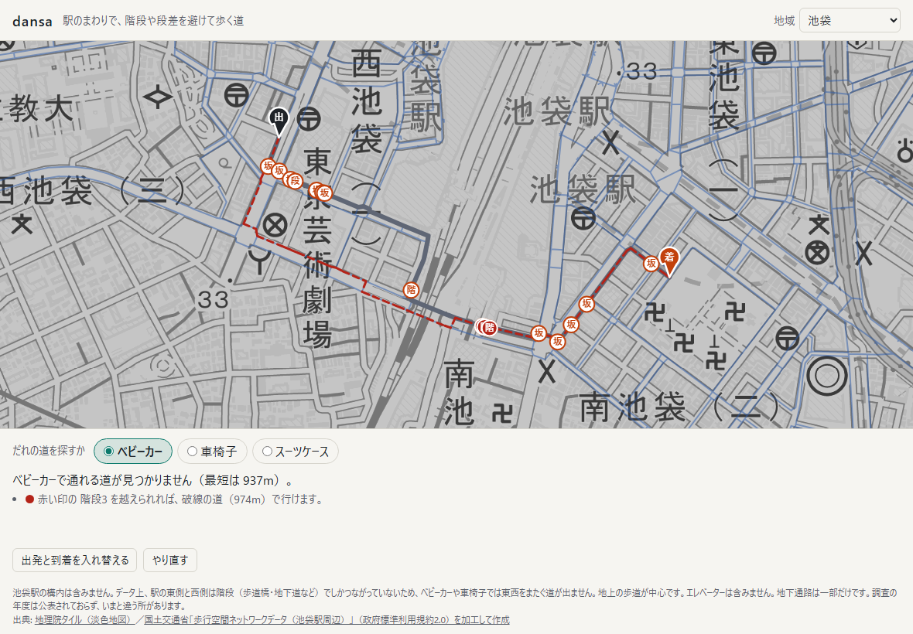

# dansa

駅のまわりで、階段や段差、急な坂を避けて歩く道を探す。東京駅・丸の内、渋谷〜新宿、池袋、上野の4地域に対応している。ベビーカー・車椅子・スーツケースを切り替えると、同じ2点でも道が変わる。最短の道と並べて、何を避けて何m遠回りしたかを示す。

**アプリ:** https://tame0522works-art.github.io/dansa/ （PC とスマホのブラウザで、開くだけで使える。地域を選び、地図を2回押すと、出発地から目的地までの道が出る）


歩行経路のデータは国土交通省の「歩行空間ネットワークデータ」を使い、道の探索は端末の中で行う。
公開版は Content Security Policy で通信（fetch など）をすべて禁じ、例外は背景の地理院タイルの画像を読むことだけにしている。

## できること

| 同じ2点のベビーカー向け（+17m） | 池袋で東西をまたぐとき | 車椅子で行けないとき | スマホ |
|---|---|---|---|
|  |  |  |  |

- **地域を選ぶ**: 見出しの「地域」で切り替える。データは選んだときに読み込み、地図の位置・出発地・目的地はその地域の最初からになる（利用者の選択は残る）
- **2点を押すだけ**: 地図を押すと出発地、もう一度押すと目的地。いちばん近い道の上の点に寄せる（60m より遠ければ「データがありません」と案内）
- **利用者を切り替える**: ベビーカー・車椅子・スーツケースで、避けるものと避け方が違う（下の表）
- **最短の道と並べる**: 灰色が最短、緑が利用者向け。最短の道にあって避けた障害に印を置き、長さの差と避けた障害の数を出す。避けるより通ったほうが短いと判断した障害（車椅子の急な坂、スーツケースの階段など）も緑の印で示す
- **行けないときは理由を示す**: 越えられない箇所に赤い印を置き、その箇所さえ越えれば行ける道を破線で描く。越えられない箇所が出発地か目的地のすぐそば（建物の入口の段差など）なら、置き直すよう案内する
- **調べられていない区間**: 段差・勾配・幅が不明な区間は点線と「?」の印にする（通れる扱いにして、少し遠回りしてでも避ける）
- **地域ごとの注意**: 地下通路・エレベーターの有無と、範囲の欠け（上野駅の東側は範囲外、池袋は東西が階段でしかつながっていない）を画面の下に出す
- **キーボードでも使える**: Tab で地域の選択、地図の順に移る。地図では中央に十字と案内が出て、矢印キーで動かし、+ と − で寄せ引き、Enter で十字の地点を選ぶ。利用者はラジオボタンを矢印キーで選ぶ

## 作りの要点

### データ: 国交省の歩行空間ネットワークデータ

国交省の配布サイトには約50地域の歩行空間データがある。そのうち「2018年3月版適用」の約25地域は列の作りが同じで、同じ変換で読める。
駅のまわりでデモが伝わりやすい4地域を選んだ。

| 地域 | 点 | 経路（総延長） | 地下 | エレベーター | 一方通行 | 同梱する大きさ（gzip） |
|---|---|---|---|---|---|---|
| 東京駅・丸の内 | 4,161 | 4,947 本（約 113km） | なし | なし | なし | 58KB |
| 渋谷〜新宿 | 7,155 | 7,921 本（約 133km） | 一部（地下通路 69 本） | 33 本 | 17 本 | 99KB |
| 池袋 | 1,887 | 2,196 本（約 40km） | 一部（地下通路 8 本） | なし | なし | 26KB |
| 上野 | 1,113 | 1,233 本（約 22km） | なし | 3 本 | なし | 15KB |

新宿駅周辺のデータも単独で配られているが、点がすべて「渋谷〜新宿」の範囲に入っていたので、そちらで足りるとした。
仕様（歩行空間ネットワークデータ等整備仕様 2018年3月版）の表と CSV を突き合わせて、使えるものと使えないものを確かめた。

| 分かったこと | どうしたか |
|---|---|
| 段差は「2cm 以下 / 超」、勾配は「5% 以下 / 超（上り・下り）」の区分だけで、cm や % の値はない | 区分だけでコストを決める。「5% を少し超える坂」と「12% の坂」は区別できない |
| 勾配は「起点より終点が高い」の向きで記録されている | 同じ坂でも、通る向きで上りか下りかを切り替える |
| 一方通行の経路がある（おもにエスカレーター） | 探索の隣接を向きつきで作る。エスカレーターは階段と分け、ベビーカー・車椅子は乗れない、スーツケースは乗れる扱いにする |
| エレベーターの経路がある（乗り場どうしの数十 cm の長さ） | 誰でも通れる扱い。乗り場は平面上ほぼ同じ位置なので、直線かどうかの確認から外す |
| 地下は地域によって一部だけある。東京駅は地上・踊り場・デッキだけ | 地域ごとに「地下通路は含みません／一部だけです」を書き分け、`check:data` で画面の設定（[`src/areas.ts`](src/areas.ts)）とデータを突き合わせる |
| 池袋は、ベビーカーで通れる経路だけでつなぐと東（987 点）と西（877 点）に分かれ、境の 12 本はすべて階段 | 駅の構内がデータにないためで、画面に注意を出す |
| 経路は両端を結ぶ直線とほぼ一致する（差は1割以内。0.1m 単位の丸めで、0.2m の経路だけは2割ずれる） | 形状は CSV の両端の点だけで描く |
| 調査の年度は東京駅だけ分かる（2017〜2018 年度）。ほかの地域は配布ページにもファイルにも書かれていない | いまの様子と違う所がありうると画面に書く |

取得は `npm run fetch`（配布元は利用者エージェントのない要求に 403 を返す）、変換は `npm run convert`。
地域ごとのデータ（`src/data/<地域>.json`。座標は駅のあたりを原点にした cm、長さは dm の整数）は JS の別ファイルとしてビルドされ、選んだときに読み込む。
アプリと同じ場所から読むので、CSP の `script-src 'self'` の範囲に収まり、通信の制限は変わらない。

### 利用者ごとのコスト表

コストの単位は「何 m 歩くのと同じくらい避けたいか」にした。階段と段差は1か所ごとの上乗せ、坂と狭い道は長いほどつらいので長さに掛ける倍率で表す（[`src/route.ts`](src/route.ts)）。

| | ベビーカー | 車椅子 | スーツケース |
|---|---|---|---|
| 階段 | 通れない | 通れない | +150m |
| エスカレーター | 通れない | 通れない | +0m |
| 段差 2cm 超 | +60m | 通れない | +20m |
| 勾配 5% 超の上り | ×2 | ×4 | ×1.3 |
| 勾配 5% 超の下り | ×1.5 | ×2 | ×1.1 |
| 幅 1m 未満 | ×1.5 | 通れない | ×1.2 |
| 不明な区間 | +50m | +50m | +50m |

**この値は仮置きで、当事者の声や指針で裏付けたものではない。** 表を1か所にまとめてあるので、根拠のある値に差し替えられる。

最初は車椅子の急な上り坂を「通れない」にしていた。東京駅だけのときは無作為な2点の約8割で道が出たが、地域を広げると坂の多い渋谷〜新宿で 6%、上野で 19% まで落ちた。
ふさいでいる箇所の上位は長さ2m前後の短い経路（歩道の切り下げのような所）で、データの区分では長い急坂と見分けられない。
そこで「通れるが、とても避けたい」（長さの4倍）に変え、通る坂は印と説明で示すことにした。

| 車椅子で道が出た割合（無作為な 300 組） | 東京駅 | 渋谷〜新宿 | 池袋 | 上野 |
|---|---|---|---|---|
| 急な上り坂を「通れない」 | 79% | 6% | 33% | 19% |
| 急な上り坂を「×4」 | 86% | 75% | 48% | 76% |

池袋は、東西をまたぐ組が階段のため行けないので、半分ほどにとどまる。

### 探索と「行けない理由」

探索はダイクストラ法を自前で書いた（隣接は向きつきの CSR、優先度つきキューは2分ヒープ。1回 0.1〜0.7ms）。
行けないときは、通れない障害を「1か所 100km 歩くのと同じ」とみなしてもう一度探す。
こうすると、通れない箇所をいちばん少なく通る道が見つかり、その上の通れない箇所が利用者に示す原因になる。
距離が長くても、通れない箇所が少ない道のほうが選ばれる。一方通行を逆に通る道は、このときも作らない。

丸の内の中でも車椅子で行けない組があり、調べるとどれも目的地の直前の段差1か所が原因だった（多くは建物の入口）。
そこで、原因が出発地か目的地に接しているときは置き直すよう案内し、出発地・目的地の印をピンにして、地点の上に浮かせた（地点に重なる段差の印を隠さないように）。

### 確かめ方の工夫

- `check:route` は、手で答えの出せる小さなネットワーク（階段の遠回り、坂の向きと倍率、段差・幅、不明、一方通行、エスカレーター、エレベーター、行けない理由）に加えて、
  4地域の実データ 1,920 組をすべての辺を緩和し続ける素朴な方法（ベルマン–フォード法）と照合する。返した道をたどり直して、コストと長さが合うことも見る
- 長さを 0.1m ずつ小数で足していたとき、出発と到着を入れ替えると 836m が 835m になった（835.5 が 835.4999… になる）。
  dm の整数で足してから直し、一方通行のない地域では、最短の道は向きを入れ替えても同じ長さになることを `check:route` で確かめている
- `check:data` は地域ごとに、コードの値・端点・直線とみなせるか・つながり方と、画面の注意（地下・エレベーターの有無）がデータと合うかを確かめる
- `check:contrast` は、画面の色（ライト・ダーク）と地図に描く色（経路・印・ピンの文字）のコントラスト比を確かめる

### 通信するのは地図の画像だけ

これまでの作品と同じく、公開版は CSP の `connect-src 'none'` で fetch などの通信をすべて拒否し、地理院タイルだけを `img-src` で許している。
タイルは `crossOrigin = 'anonymous'` で読むので資格情報を送らず、canvas も汚れないので画面テストで描いた結果を読み出せる。
タイルの要求からわかるのは「どのあたりの地図を見ているか」だけで、押した地点や選んだ利用者は送らない。

## 確かめ方

```bash
npm run check   # data / route / contrast
npm run e2e     # 公開と同じ設定でビルドし、画面なしの Chrome でマウス・タッチ・キーの操作を送る（11件、地理院タイルを読むのでネットが要る）
```

画面テスト（[`tools/e2e.ts`](tools/e2e.ts)）で確かめていること:

- 開くと地図・経路の網・注記と出典が出る
- 東京駅: 2点を押すと最短と車椅子向けの道が出て（836m と 857m）、ベビーカー・スーツケースに切り替えると引き直す
- 車椅子で行けないときに、越えられない箇所の印と置き直しの案内が出る（ベビーカーに切り替えると消える）
- 道のない所を押したときの案内と、やり直し
- ドラッグは押した判定にならない
- キーボードで地域の選択・地図の順に移り、地図の中央を出発地にでき、利用者を矢印キーで選べる
- 地域を切り替えると、地図・注意・出典がその地域のものになり、出発地は選び直しになる（利用者の選択は残る）
- 渋谷〜新宿: 車椅子は急な坂を避けて遠回りし（879m に対して 1,239m）、避けきれない坂は通ると示す
- 池袋: 東西をまたぐ道は、ベビーカーでは階段3か所を越えないと行けず、スーツケースなら出る
- 公開版の CSP（fetch は拒否、タイルの画像は読める）
- スマホで指で押せて、利用者の選択肢が1行に収まり、横にはみ出さない

README の画像は `npm run build` → `npm run preview` のあとに `npm run screenshots` で撮り直せる。

## 扱っていないこと

- 地下街・駅構内のほとんど（地下通路は一部の地域に一部だけ）。駅構内のエレベーター
- 段差の高さ・坂の傾きの値（データは区分だけ）。歩道の混雑・工事・天候
- コスト表の値の裏付け（上の表は仮置き）
- 調査より後に変わった道（東京駅は 2017〜2018 年度、ほかの地域は年度が公表されていない）
- 4地域のほかの地域（同じ形式のデータは約20地域ある）

## データの出典

- 歩行経路: 国土交通省「歩行空間ネットワークデータ」（2018年3月版適用、[政府標準利用規約 第2.0版](https://www.hokoukukan.go.jp/tos.html)）を加工して作成
  - [東京駅周辺](https://www.hokoukukan.go.jp/metadata/detail/80)
  - [東京都渋谷区・渋谷駅、千駄ヶ谷駅周辺／東京都新宿区・新宿駅周辺](https://www.hokoukukan.go.jp/metadata/detail/275)
  - [池袋駅周辺](https://www.hokoukukan.go.jp/metadata/detail/82)
  - [台東区上野駅周辺](https://www.hokoukukan.go.jp/metadata/detail/84)
- 属性の意味: 国土交通省「[歩行空間ネットワークデータ等整備仕様](https://www.mlit.go.jp/common/001244374.pdf)」（2018年3月）
- 地図: [地理院タイル](https://maps.gsi.go.jp/development/ichiran.html)（淡色地図）を灰色にして表示

## 開発

```bash
npm install
npm run dev       # http://localhost:5203/
npm run fetch     # 国交省の CSV を raw/<地域>/ に取る（raw/ は git に入れない）
npm run convert   # raw/ を src/data/<地域>.json に変換する
```
